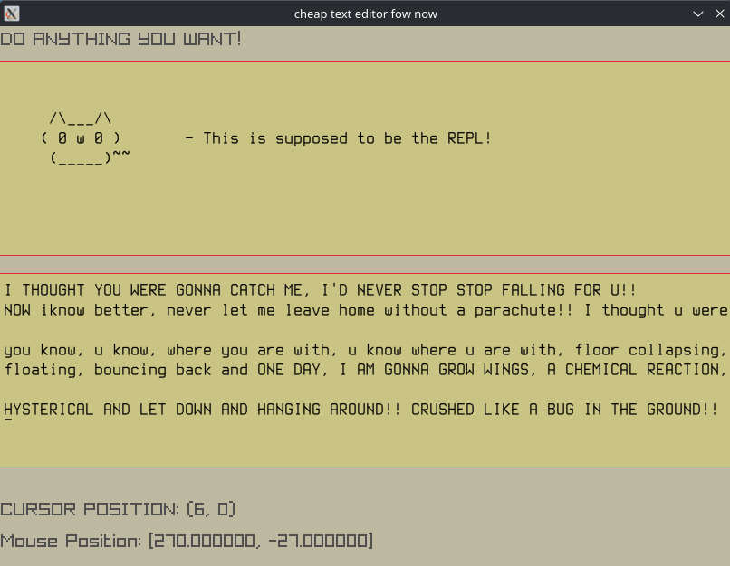

just as the name says, this repo is an attempt to recreate the cool `object inspection` and `live programming` stuff of a Lisp Listener using raylib in c/c++. 

the editor works now, u can type, scroll up/down, left/right using the arrow keys.

here's a screenshot:



## P. S. 

if u wanna try it yourself, which u obviously do (for the basic typing and all, u know to feel whats it like to write on potentially the world's best LISP Listener), then u can go ahead and download the [statically linked executable](https://github.com/theintrospectiveidiot/wannabe-lisp-listener/blob/master/edi.tar), it doesn't require dynamic raylib linking, but u do need x11 and some more things...

here's the stuff u need (and raylib isnt one of them, yay!):

```
-libc
-lm
-lX11
```

the first two are installed on almost all Linux machines, and the X11, u can install it according to ur distro.

YAY!!!


